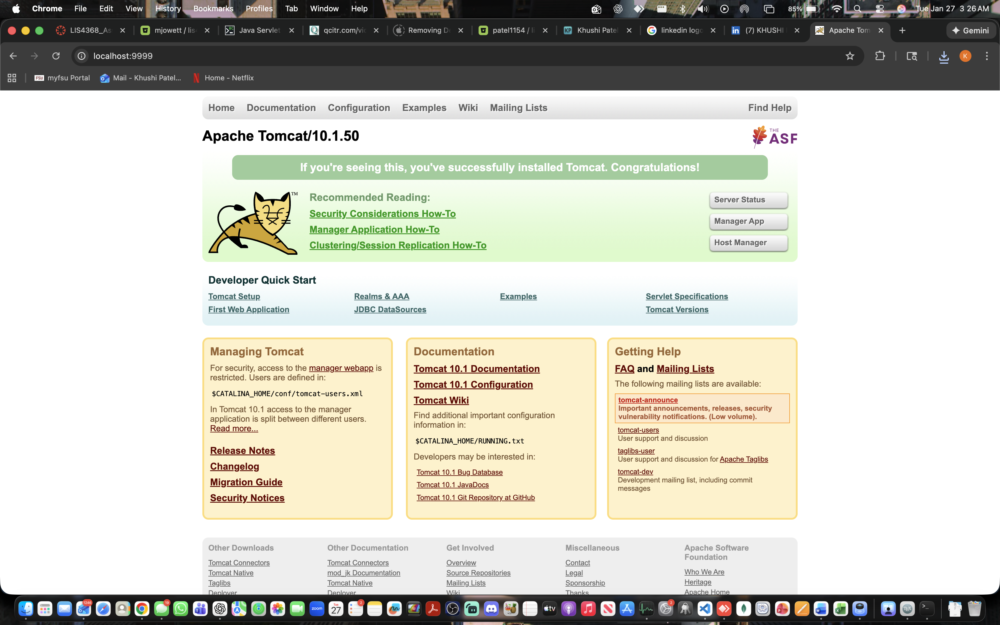

> **NOTE:** This README.md file should be placed at the **root of your main directory.**

# LIS4368 - Advanced Web Application Development

## Khushi Patel

## Course Overview and Requirements

This repository contains all assignments and projects for LIS4368.  
Each assignment/project is documented in its own `README.md` inside the respective folder.  
Each folder includes screenshots, code explanations, and required deliverables.

---

## Course Work Links

1. [A1 README.md](a1/README.md "Assignment 1 README.md")

   - Install required tools (AMPPS, JDK, Apache Tomcat)
   - Configure and run Tomcat locally
   - Initialize a Git repository and push to Bitbucket/GitHub
   - Include screenshots (AMPPS, Java, Tomcat, etc.) in `a1/README.md` using Markdown image tags
   - Document basic Git commands used for this assignment

   

## Tomcat Running

2. [A2 README.md](a2/README.md "Assignment 2 README.md")

3. [A3 README.md](a3/README.md "Assignment 3 README.md")

4. [A4 README.md](a4/README.md "Assignment 4 README.md")

5. [A5 README.md](a5/README.md "Assignment 5 README.md")

6. [P1 README.md](p1/README.md "Project 1 README.md")

7. [P2 README.md](p2/README.md "Project 2 README.md")

--------

## Basic Git Commands Used

git clone <repo_url>        # Clone the remote repository
git status                  # Check the status of tracked/untracked files
git add .                   # Stage all modified/created files
git commit -m "message"     # Commit staged changes with a message
git push                    # Push local commits to remote (Bitbucket/GitHub)
git pull                    # Fetch and merge latest changes from remote

If you had to remove the original .git and reinitialize:

rm -rf .git                 # Remove existing Git history (Mac/Linux)
git init                    # Initialize a new Git repository
git remote add origin <url> # Link to remote repository
git push -u origin main     # Push first commit and set upstream branch