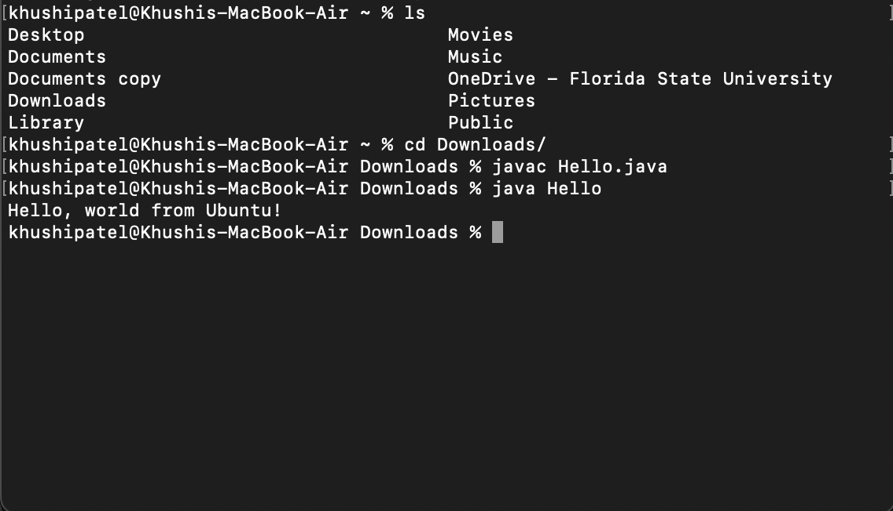

# LIS4368 - Assignment 1

## Khushi Patel  
Course: LIS4368 - Mobile Web Application Development

### Assignment 1 Requirements

1. Verify Java installation and run a simple `Hello` program
2. Install and run Apache Tomcat at `http://localhost:9999`
3. Create and run the `a1/index.jsp` file in the browser
4. Use Git to initialize and manage the assignment repository

> README.md file (for A1) should include the following items:
>
> - Screenshot of running Java Hello in the terminal  
> - Screenshot of `http://localhost:9999` in the browser  
> - Screenshot of `a1/index.jsp` in the browser  
> - Git commands with short descriptions  
>
> #### Git commands w/short descriptions:
>
> 1. **git clone \<repo_url\>** – Copy remote repository to local machine  
> 2. **git status** – Show changes (staged, unstaged, untracked)  
> 3. **git add .** – Stage all modified and new files  
> 4. **git commit -m "message"** – Save staged changes with a message  
> 5. **git push** – Upload local commits to the remote repository  
> 6. **git pull** – Fetch and merge latest changes from remote  
> 7. **git rebase origin/main** – Reapply local commits on top of the latest `main`  
> 8. **rm -rf .git** – Remove existing Git history (if reinitializing)  
> 9. **git init** – Start a new local Git repository  
> 10. **git remote add origin \<url\>** – Link local repo to remote  
> 11. **git push -u origin main** – Push first commit and set upstream branch  

---

#### Assignment 1 Screenshots (Note: **BE SURE** to modify paths/file names for your repo!)

_Screenshot of running Java Hello program in the terminal_:

_Screenshot of Apache Tomcat running at http://localhost:9999_:

_Screenshot of a1/index.jsp displayed in the browser_:

