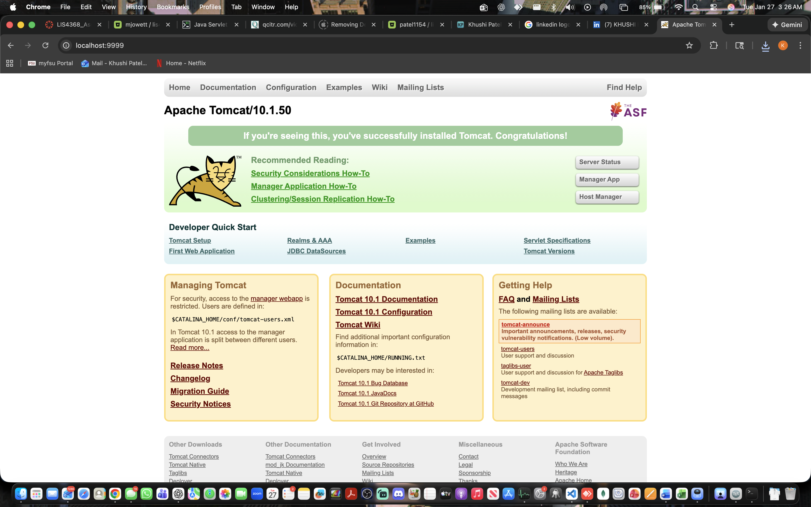
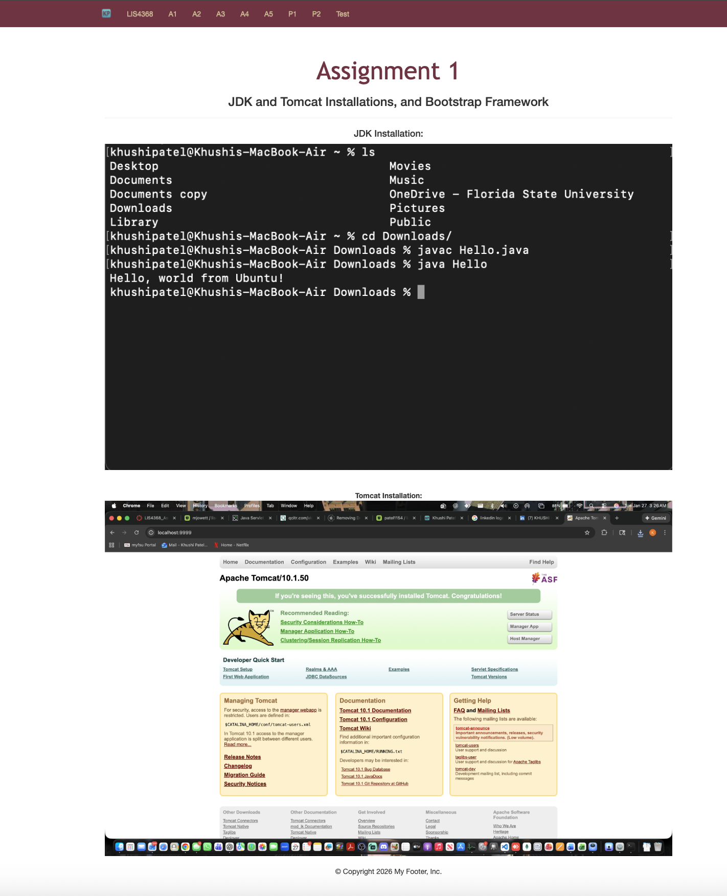

Here’s a cleaned up and corrected version of your a1/README.md in proper Markdown:

# LIS4368 - Assignment 1

## Student: Khushi Patel  
Course: LIS4368 - Mobile Web Application Development

---

## Assignment Overview

Assignment 1 focuses on setting up the development environment and confirming that Java and Apache Tomcat are working correctly.  
This assignment includes:

- Verifying Java installation and running a simple "Hello" program  
- Starting Apache Tomcat and confirming it is available at `http://localhost:9999`  
- Creating and running the `a1/index.jsp` file  
- Using Git to initialize and manage the assignment repository  

---

## Environment Setup

### 1. Java Installation

- Installed Java Development Kit (JDK) on the system  
- Verified installation using `java -version` in the terminal  

### 2. Apache Tomcat

- Installed Apache Tomcat  
- Configured Tomcat to listen on port `9999`  
- Started the Tomcat server from the terminal  

### 3. Project Structure

The key structure for this assignment:

```text
root/
  README.md
  a1/
    README.md
    index.jsp
    images/
      java-hello.png
      localhost-9999.png
      a1-index.png


⸻

1. Java Hello Program

Description:
Java “Hello” program compiled and executed successfully in the terminal.

Commands used:

javac Hello.java
java Hello

⸻

2. Apache Tomcat - http://localhost:9999

Description:
Apache Tomcat is running and serving the default page at http://localhost:9999 in the browser.
This confirms that Tomcat is correctly installed and listening on the configured port.


⸻

3. a1/index.jsp Running in Browser

Description:
The a1/index.jsp file is deployed under the Tomcat webapps folder and accessed through the browser.
This confirms that JSP files are being compiled and served correctly by the server.

⸻

Basic Git Commands Used

Below are the Git commands used during Assignment 1, along with short descriptions.

git clone <repo_url>
# Clone the remote repository to the local machine

git status
# Show the status of tracked and untracked files

git add .
# Stage all modified and new files for commit

git commit -m "Initial commit for A1"
# Commit staged changes with a descriptive message

git push
# Push local commits to the remote repository

git pull
# Fetch and merge the latest changes from the remote repository

If the original .git history needed to be removed and the repository reinitialized:

rm -rf .git
# Remove existing Git history (Mac or Linux)

git init
# Initialize a new local Git repository in the current folder

git remote add origin <url>
# Link the local repository to a remote repository

git push -u origin main
# Push the first commit and set 'main' as the upstream branch

git rebase origin/main
# Reapply local commits on top of the latest 'main' from the remote

--------

#### Assignment 1 Screenshots (Note: **BE SURE** to modify paths/file names for your repo!)

_Screenshot of running Java Hello program in the terminal_:


_Screenshot of Apache Tomcat running at http://localhost:9999_:



_Screenshot of a1/index.jsp displayed in the browser_:



