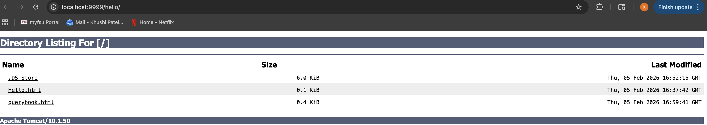
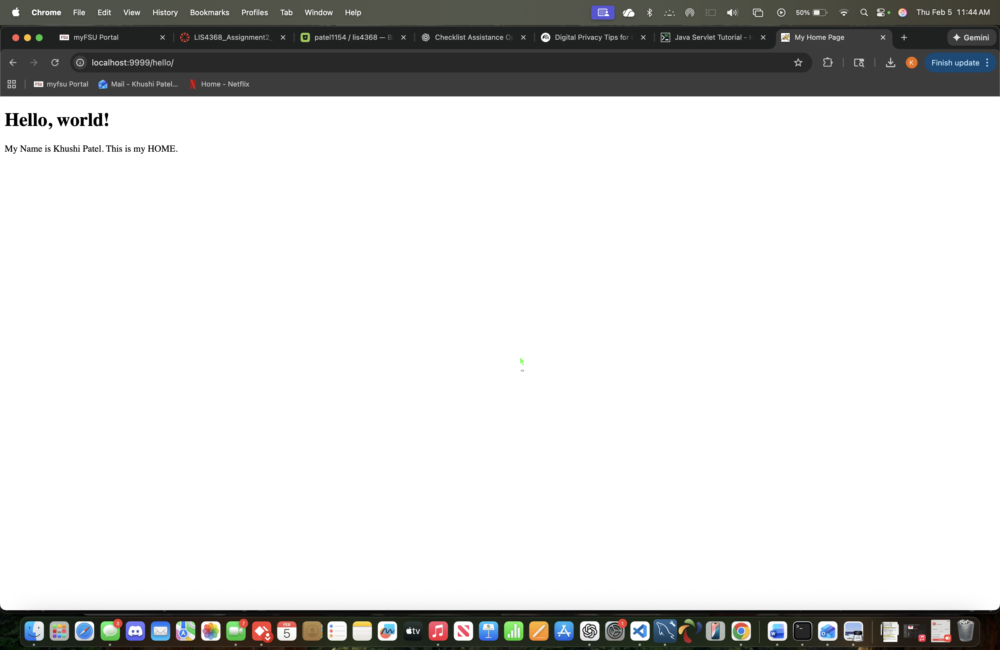
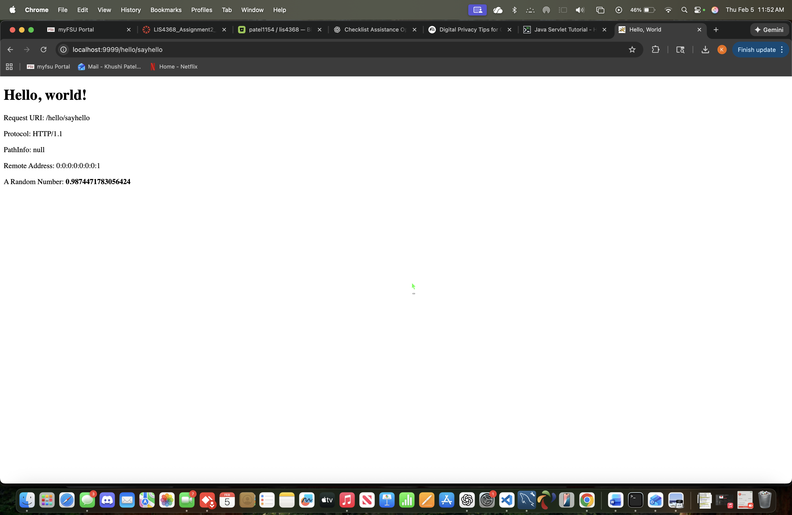
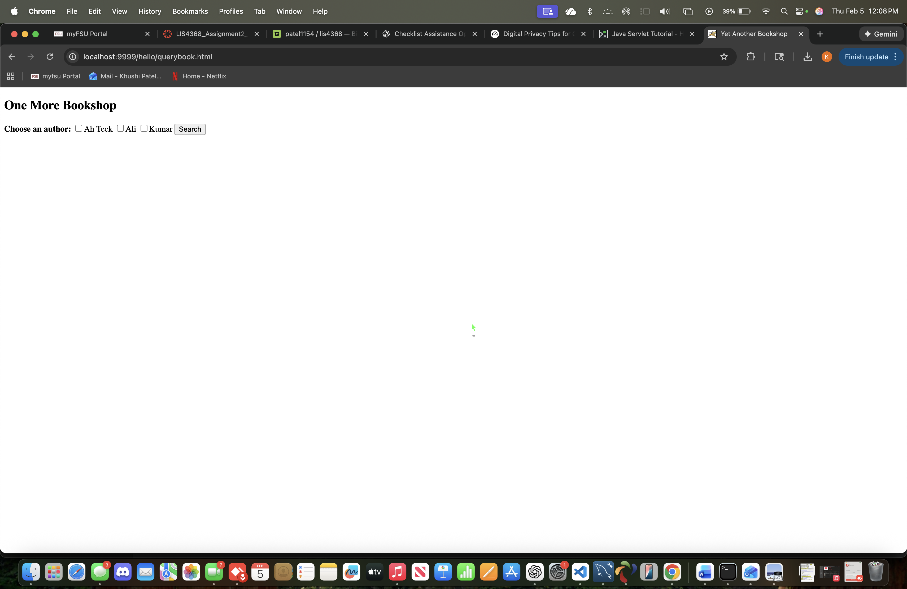
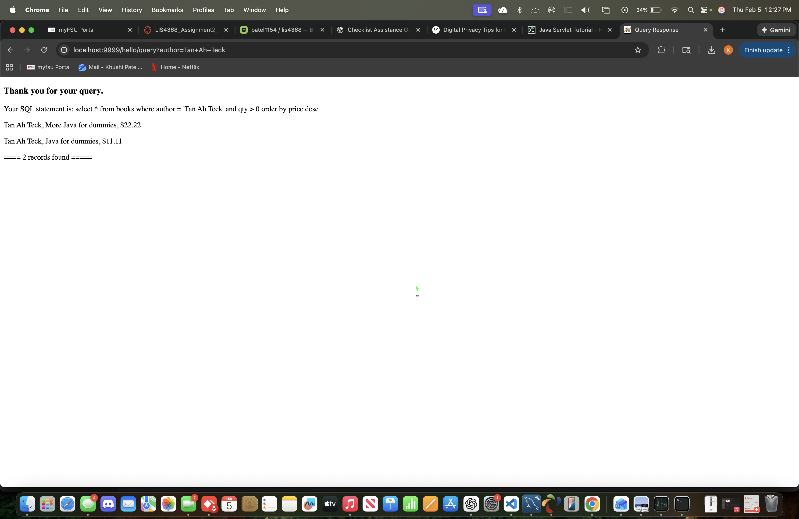
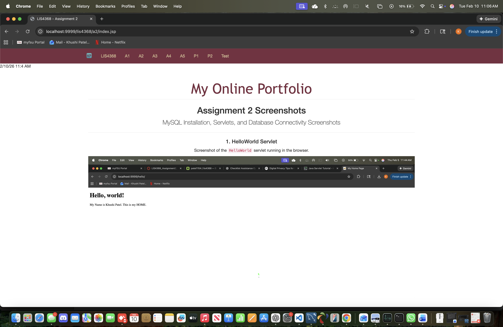
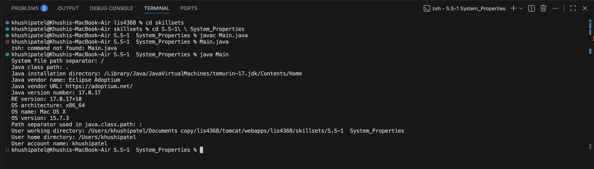
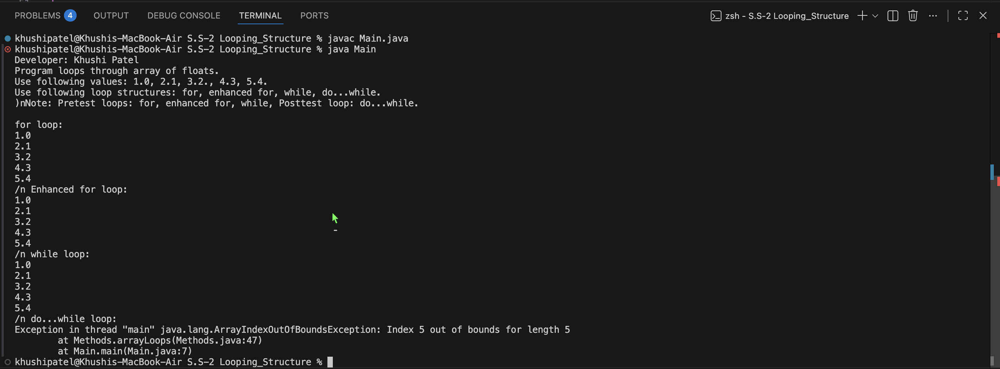
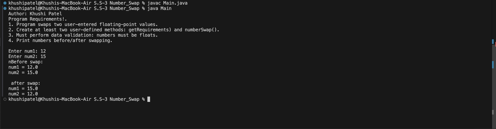

# LIS4368 - Assignment 2

## Khushi Patel

Course: LIS4368 - Advanced Web Applications Development

---

## Assignment 2 Requirements

1. Configure and run servlet examples (HelloWorld / SayHello).
2. Deploy and test `querybook.html` for querying the `ebookshop` database.
3. Verify that the servlet correctly processes the query and displays results.
4. Deploy and run `a2/index.jsp` and confirm it renders correctly in the browser.
5. Capture screenshots of each required step and include them in this README.

> README.md file (for A2) should include the following items:
>
> - Screenshot of the **HelloWorld** servlet running in the browser
> - Screenshot of the **SayHello** (or `/hello/sayhi`) servlet running in the browser
> - Screenshot of the **querybook.html** page in the browser
> - Screenshot of the **querybook** query results page
> - Screenshot of the **a2/index.jsp** page running in the browser
> - Skillset screenshots (three images: `ss1.png`, `ss2.png`, `ss3.png`)

---

## Assignment 2 Screenshots

> All images are stored in the `a2/img/` directory. [http://localhost:9999/hello/](http://localhost:9999/hello/)
> 

### 1. HelloWorld Servlet

Screenshot of the `HelloWorld` servlet running in the browser: [http://localhost:9999/hello/Hello.html](http://localhost:9999/hello/Hello.html)

---

### 2. SayHello Servlet

Screenshot of the `SayHello` (or `/hello/sayhi`) servlet running in the browser:[http://localhost:9999/hello/sayhello](http://localhost:9999/hello/sayhello)

---

### 3. querybook.html Form

Screenshot of `querybook.html` form page in the browser:[http://localhost:9999/hello/querybook.html](http://localhost:9999/hello/querybook.html)

---

### 4. querybook Query Results

Screenshot of the query results page after submitting `querybook.html` against the `ebookshop` database:[http://localhost:9999/hello/query?author=Tan+Ah+Teck](http://localhost:9999/hello/query?author=Tan+Ah+Teck)

---

### 5. a2/index.jsp Running in Browser

Screenshot of the `a2/index.jsp` file running in the browser:[http://localhost:9999/lis4368](http://localhost:9999/lis4368)

---

### Skillsets Screenshots

| Skillset #1                 | Skillset #2                 | Skillset #3                 |
| --------------------------- | --------------------------- | --------------------------- |
|  |  |  |
