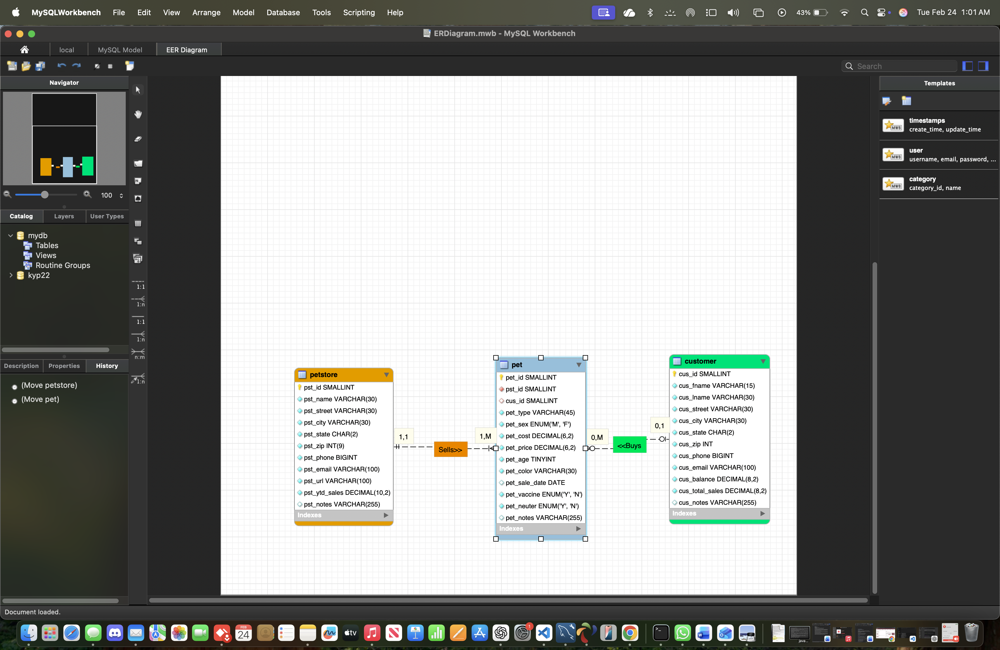
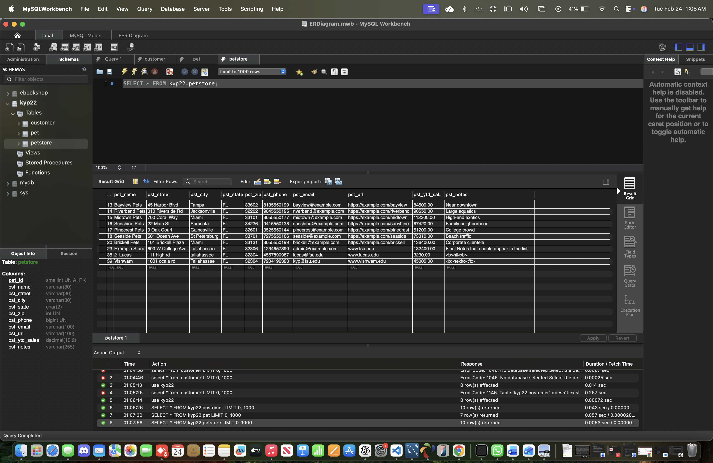
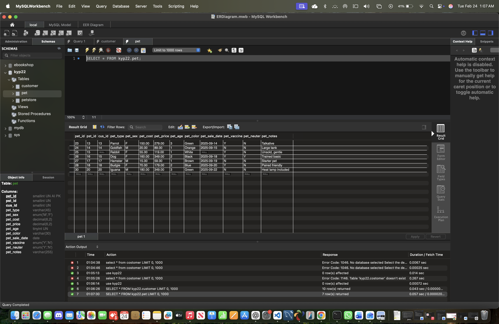
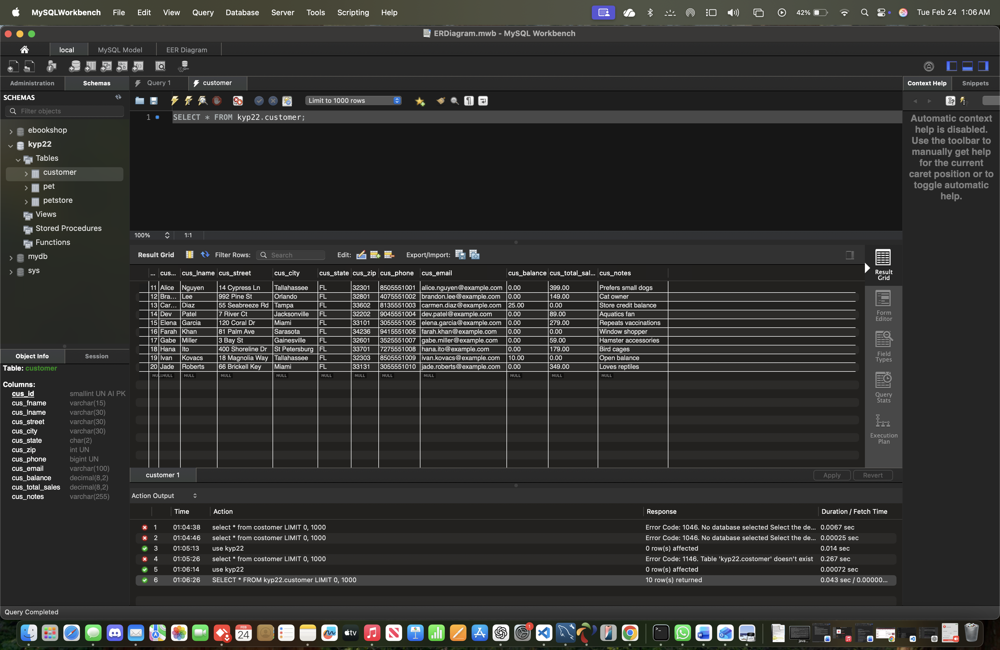
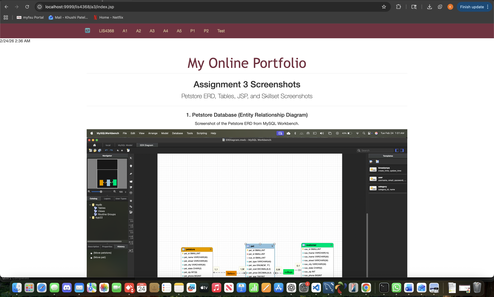
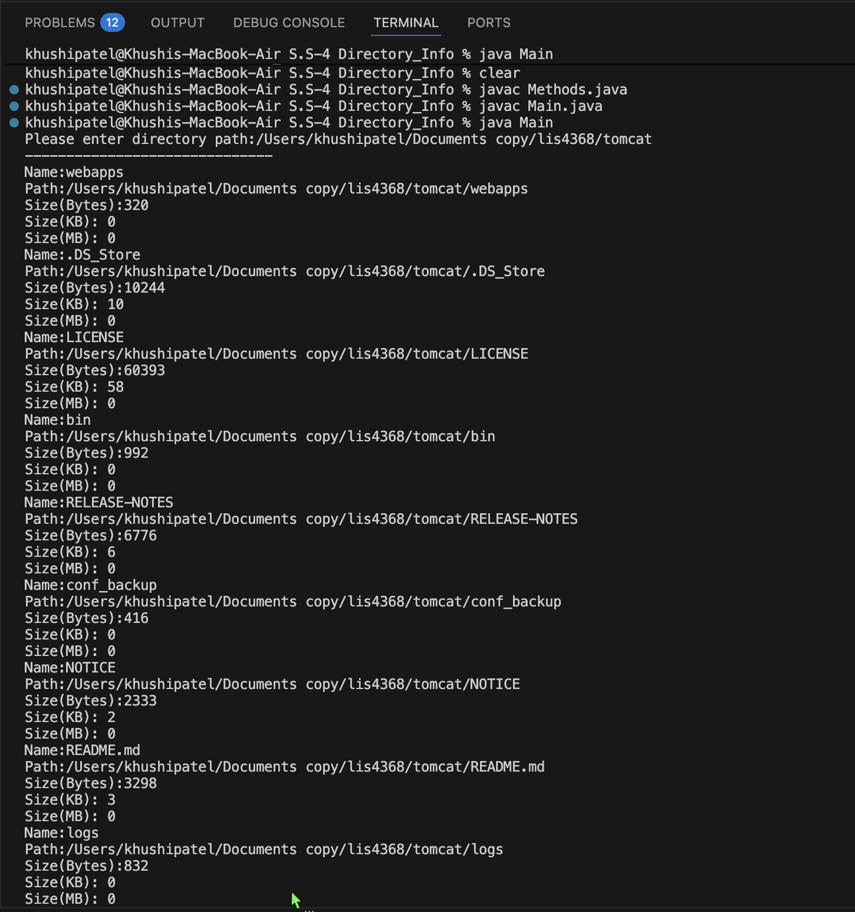
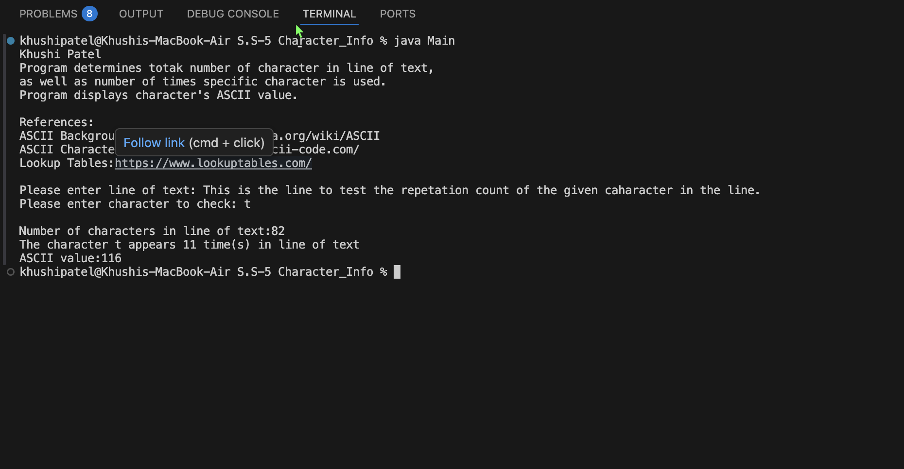
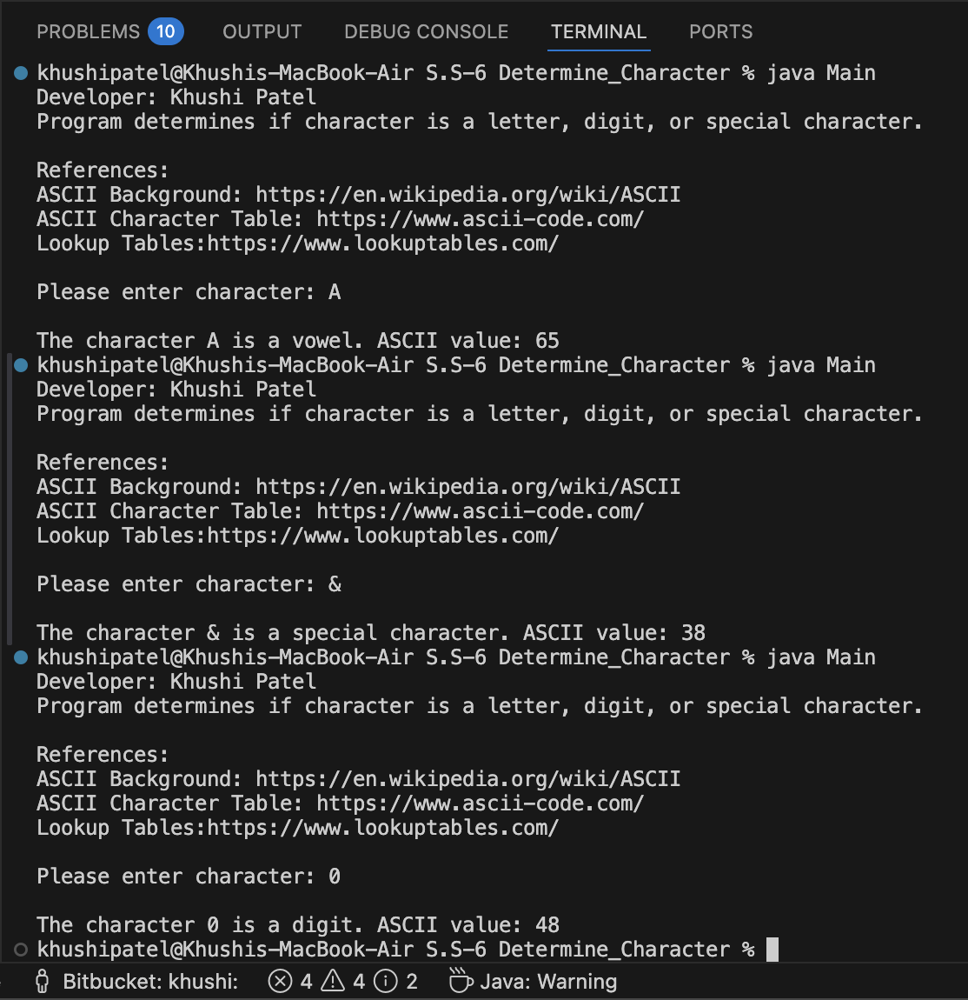

# LIS4368 - Assignment 3

## Khushi Patel

Course: LIS4368 - Mobile Web Application Development

---

## Assignment 3 Requirements

Pet store data design and database implementation based on the given business rules. This assignment includes:

1. Design an Entity Relationship Diagram (ERD) for the Pet's R-Us business.
2. Create all tables in MySQL Workbench, matching data types and relationships from the ERD.
3. Insert at least 10 unique records for each table and verify that the tables forward engineer locally.
4. Export the data model and data as an SQL script.
5. Create and run `a3/index.jsp` to integrate with the rest of the course repo.
6. Place the following files in the `a3/docs/` subdirectory:
   - `a3.mwb` (MySQL Workbench file)
   - `a3.sql` (Forward Engineer SQL CREATE script)
7. Complete Skillsets 4, 5, and 6 and include their screenshots in this README.

> README.md file (for A3) should include the following items:
>
> 1. Course title, your name, assignment requirements (as above).
> 2. Screenshot of ERD.
> 3. Screenshots of 10 records for each table (use `SELECT * FROM table_name;`).
> 4. Screenshot of `a3/index.jsp`.
> 5. Links to `a3.mwb` and `a3.sql` in the `docs` folder.
> 6. Skillset screenshots for Skillsets 4, 5, and 6.

---

## Assignment 3 Screenshots and Links

> All images are stored in the `a3/img/` directory. Update file names if yours differ.

### 1. Screenshot A3 ERD

_Screenshot of the ERD based on the A3 business requirements:_

---

### 2. Table Data Screenshots (10 Records Each)

_Run `SELECT * FROM table_name;` for each table and capture the first 10 records._

#### 2.1 petstore Table

_Screenshot of 10 records from the `petstore` table:_

#### 2.2 pet Table

_Screenshot of 10 records from the `pet` table:_

#### 2.3 customer Table

_Screenshot of 10 records from the `customer` table:_

> Note: If you used different table names (for example `store`, `pets`, `customers`), rename the captions and image files to match your design.

---

### 3. a3/index.jsp Running in Browser

_Screenshot of the `a3/index.jsp` page running in the browser:_

---

### 4. Skillsets Screenshots (Skillsets 4, 5, and 6)

| Skillset #4 – Directory_Info              | Skillset #5 – Character_Info              | Skillset #6 – Determine_Character                   |
| ----------------------------------------- | ----------------------------------------- | --------------------------------------------------- |
|  |  |  |

> Make sure the files `Directory_Info.png`, `Character_Info.png`, and `Determine_Character.png` are stored in the `a3/img/` directory and that the names match exactly (including case).

---

## A3 Docs: a3.mwb and a3.sql

The ERD file and SQL script are stored in the `a3/docs/` directory.

- [A3 MWB File](docs/a3.mwb "A3 ERD in .mwb format")
- [A3 SQL File](docs/a3.sql "A3 SQL Script")

---

## Notes

- Make sure the `.mwb` and `.sql` filenames are exactly `a3.mwb` and `a3.sql` and that they are located in the `a3/docs/` subdirectory.
- Verify that each table has at least 10 unique records and that you can run `SELECT * FROM table_name;` successfully after forward engineering locally.
- Update image filenames in this README if your screenshot names differ from the placeholders used here (`ERD_screenshot.png`, `petstore_table.png`, `pet_table.png`, `customer_table.png`, `a3_index.png`, `Directory_Info.png`, `Character_Info.png`, `Determine_Character.png`).
