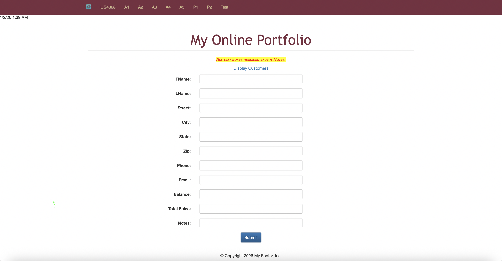
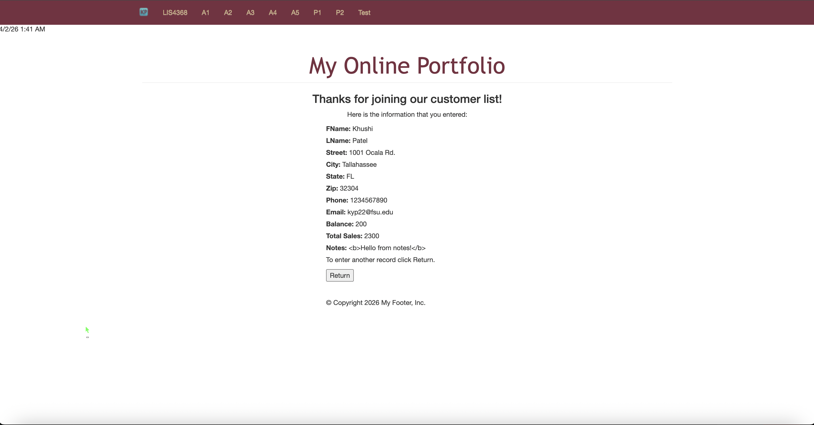
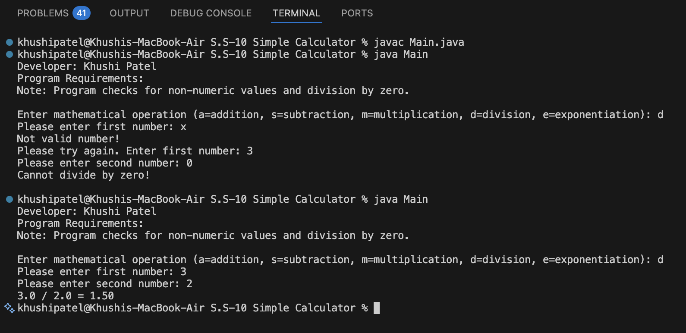
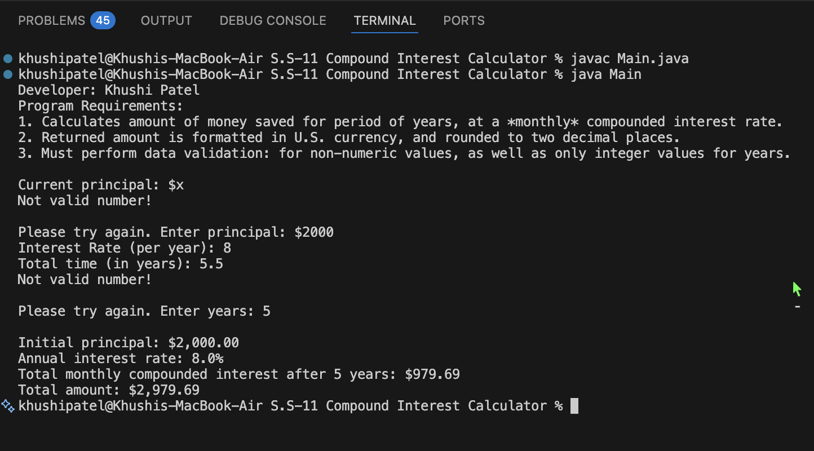
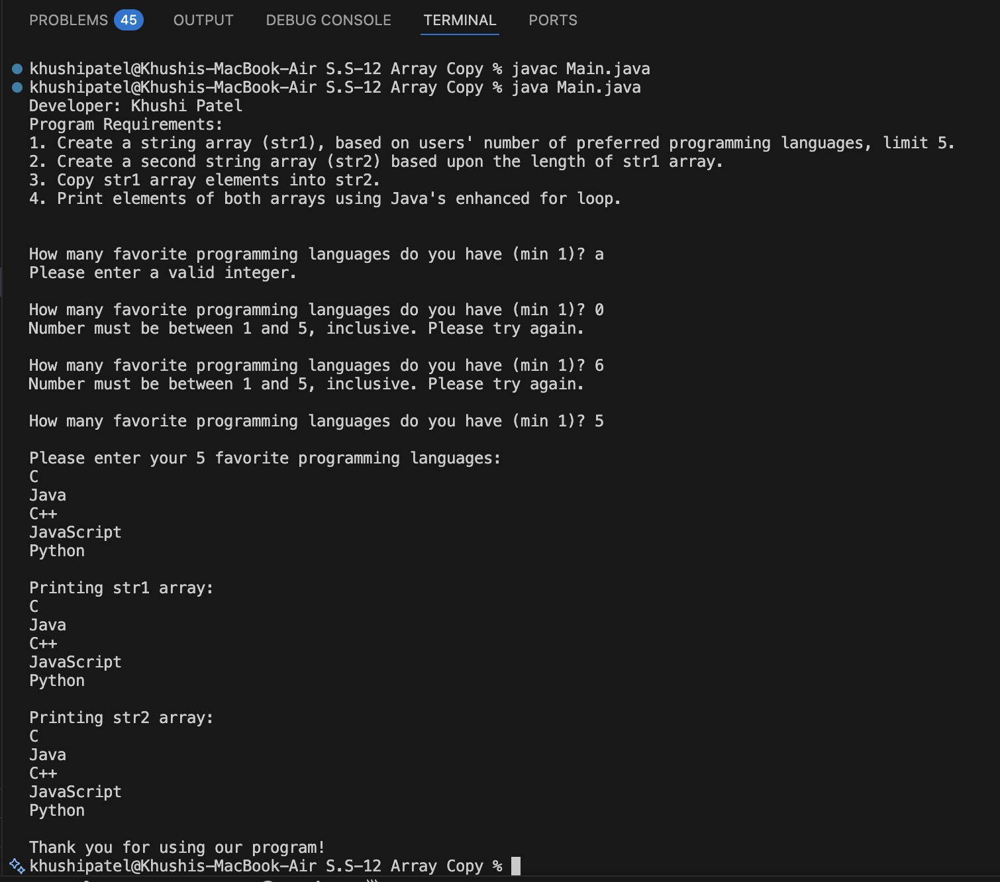

# LIS4368 - Assignment 4

## Khushi Patel

Course: LIS4368 - Mobile Web Application Development

---

## Assignment 4 Requirements

Assignment 4 focuses on applying the MVC pattern and separation of concerns using JSPs, servlets, and business classes for customer form processing and validation. This assignment includes:

1. Review the previously cloned `lis4368_student_files` Bitbucket repo, especially the `META-INF` and `WEB-INF` subdirectories.
2. Ensure each assignment has its own `global` subdirectory.
3. Compile and use the following business and servlet files:
   - `crud/business/Customer.java`
   - `crud/admin/CustomerServlet.java`
4. Add server-side validation to the customer form and process form submissions through the servlet.
5. Update the related JSP pages for form display, customer listing, and successful submission.
6. Push all updated `lis4368` files to the remote Bitbucket repository.
7. Provide Bitbucket read-only access and submit the repo link in FSU’s Learning Management System. [oai_citation:0‡LIS4368_Assignment4_Spr26.pdf](sediment://file_000000001ac471f5b11fca2cc0fc3d21)

> README.md file (for A4) should include the following items:
>
> 1. Course title, your name, and assignment requirements.
> 2. Screenshot of failed validation.
> 3. Screenshot of passed validation.
> 4. Screenshot of updated `a4/index.jsp`.
> 5. Skillset screenshots for Skillsets 10, 11, and 12.
> 6. Short details about the updated/created files used in this assignment. [oai_citation:1‡LIS4368_Assignment4_Spr26.pdf](sediment://file_000000001ac471f5b11fca2cc0fc3d21)

---

## Assignment 4 Screenshots and Links

> All images are stored in the `a4/img/` directory. Update file names if yours differ.

### 1. Failed Validation

_Screenshot showing server-side validation failure on the customer form:_

---

### 2. Passed Validation

_Screenshot showing successful form submission and data displayed on `thanks.jsp`:_

---

### 3. Skillsets Screenshots (Skillsets 10, 11, and 12)

| Skillset #10                 | Skillset #11                 | Skillset #12                 |
| ---------------------------- | ---------------------------- | ---------------------------- |
|  |  |  |

> Make sure the files `ss10.png`, `ss11.png`, and `ss12.png` are stored in the `a4/img/` directory and that the names match exactly.

---

## Updated / Created Files

### 1. `customerform.jsp`

- Added the customer input form using Bootstrap form layout.
- Added JSTL support for conditional header loading and message display.
- Connected the form to `CustomerServlet` using:
  - `action="${pageContext.request.contextPath}/customerAdmin"`
- Added client-side validation rules using jQuery FormValidation for:
  - first name
  - last name
  - street
  - city
  - state
  - zip
  - phone
  - email
  - balance
  - total sales
- Included validation icons:
  - `fa fa-check`
  - `fa fa-times`
  - `fa fa-refresh`
- Added regex-based validation patterns for the required fields.

### 2. `thanks.jsp`

- Displays the successfully submitted customer data using JSTL `<c:out>`.
- Shows all entered field values:
  - first name
  - last name
  - street
  - city
  - state
  - zip
  - phone
  - email
  - balance
  - total sales
  - notes
- Includes a Return button that sends the user back to the form using `customerAdmin` with action `join`.

### 3. `customers.jsp`

- Displays customer records in a responsive table.
- Uses JSTL `<c:forEach>` to loop through the `users` collection.
- Includes Edit and Delete buttons for each customer row.
- Uses DataTables for table formatting and pagination.
- Includes a confirmation prompt before deleting a record.

### 4. `crud/admin/CustomerServlet.java`

- Serves as the controller in the MVC pattern.
- Processes the following actions:
  - `join`
  - `add_customer`
  - `display_customers`
  - `modify_customer`
  - `delete_customer`
- Performs server-side validation before forwarding users to the next page.
- Forwards requests to:
  - `customerform.jsp`
  - `customers.jsp`
  - `modify.jsp`
  - `thanks.jsp`
  - `index.jsp`

### 5. `crud/business/Customer.java`

- Serves as the business/model class for customer data.
- Stores all customer properties and supports passing customer data between the servlet and JSP pages.

---
