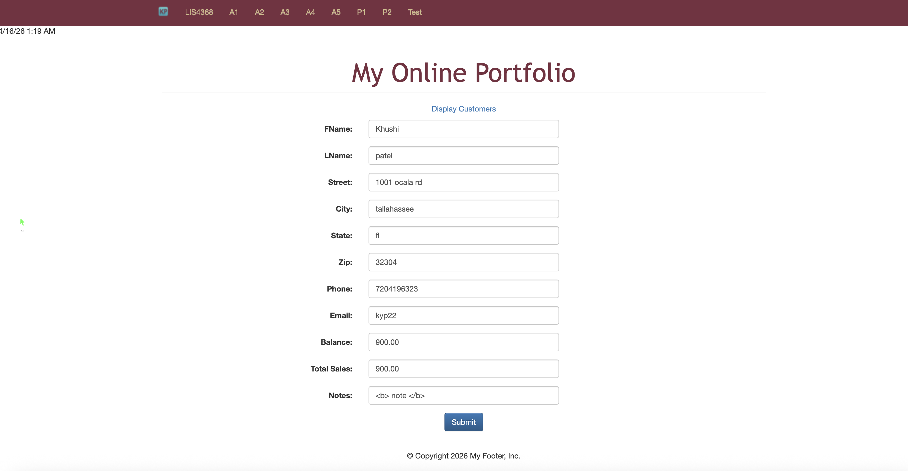
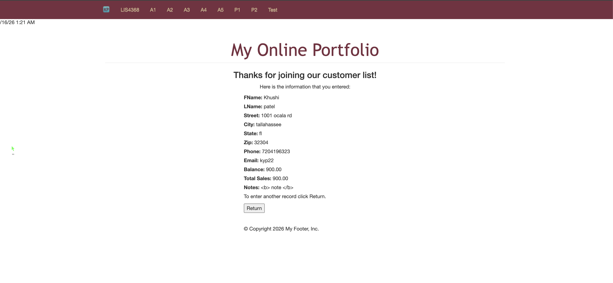
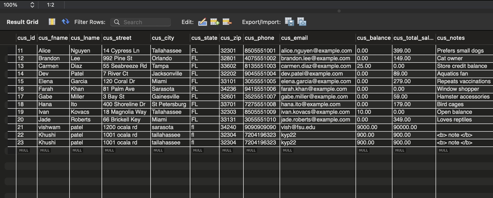
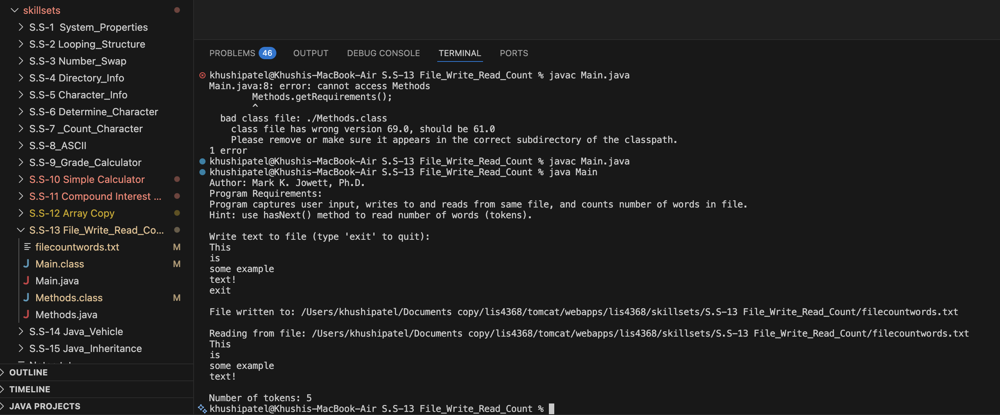
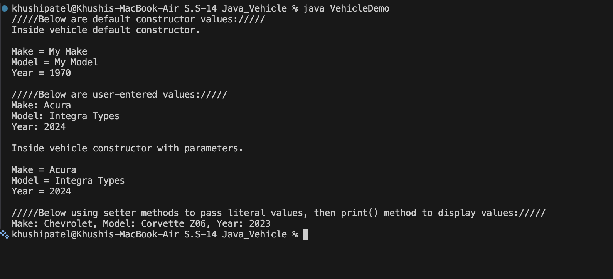
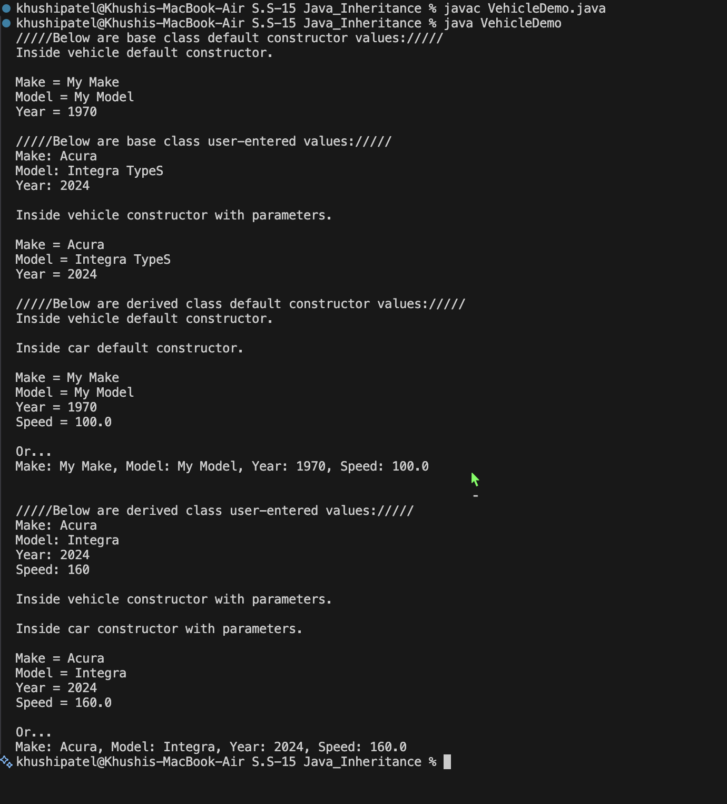

# LIS4368 - Assignment 5

## Khushi Patel

Course: LIS4368 - Mobile Web Application Development

---

## Assignment 5 Requirements

Assignment 5 focuses on extending the MVC-based customer application by adding database-driven CRUD support and continuing to use server-side validation from Assignment 4. The assignment requires reviewing the existing course repo structure, compiling the required data and servlet files, displaying screenshots of valid form entry, passed validation, and the associated MySQL database entry, and pushing all updated files to the remote Bitbucket repository. [oai_citation:0‡LIS4368_Assignment5_Spr26.pdf](sediment://file_000000004590720c8988b6864fbe1b0b)

> README.md file for A5 should include screenshots that match the assignment examples, including valid user form entry, passed validation, and associated database entry. The deliverables also require Bitbucket read-only access and submission of the Bitbucket repo link in FSU’s Learning Management System. [oai_citation:1‡LIS4368_Assignment5_Spr26.pdf](sediment://file_000000004590720c8988b6864fbe1b0b)

---

## Assignment 5 Screenshots and Links

> All images are stored in the `a5/img/` directory. Update file names if yours differ.

### 1. Valid User Form Entry

_Screenshot showing valid input entered on `customerform.jsp`:_

---

### 2. Passed Validation

_Screenshot showing successful form submission and data displayed on `thanks.jsp`:_

---

### 3. Associated Database Entry

_Screenshot showing the inserted customer row in the MySQL customer table:_

---

### 4. Skillsets Screenshots (Skillsets 13, 14, and 15)

| Skillset #13                 | Skillset #14                 | Skillset #15                 |
| ---------------------------- | ---------------------------- | ---------------------------- |
|  |  |  |

> Make sure the files `ss13.png`, `ss14.png`, and `ss15.png` are stored in the `a5/img/` directory and that the names match exactly.

---

## Updated / Created Files

### 1. `customerform.jsp`

- Displays the customer input form for Assignment 5.
- Retains server-side validation requirements from Assignment 4.
- Submits customer data through the servlet for processing and database insertion.
- Supports secure handling of customer-entered values before persistence.

### 2. `thanks.jsp`

- Displays the successfully submitted customer information after validation passes.
- Uses JSTL output tags to safely render entered values.
- Confirms that the customer record was accepted and processed correctly.

### 3. `crud/admin/CustomerServlet.java`

- Serves as the controller in the MVC pattern.
- Processes customer form submissions.
- Performs server-side validation before inserting data.
- Forwards users to the proper JSP pages based on request outcome.

### 4. `crud/data/*.java`

- Contains the data access classes used for Assignment 5.
- Supports database connectivity and CRUD-related operations for customer records.
- Works with the servlet to insert and retrieve customer information from MySQL.

### 5. `crud/business/Customer.java`

- Serves as the business/model class for customer data.
- Stores customer properties used across the form, servlet, and JSP pages.
- Supports passing validated customer data between the controller and views.

### 6. `Main.java` and `Methods.java` for Skillset 13

- Demonstrate writing user input to a file, reading from the same file, and counting tokens using `hasNext()`.
- Reinforce Java file I/O, exception handling, and scanner-based token counting.

### 7. `Vehicle.java` and `VehicleDemo.java` for Skillset 14

- Demonstrate object-oriented programming concepts using a base class.
- Include instance variables, constructors, getters, setters, and a print method.

### 8. `Car.java`, `Vehicle.java`, and `VehicleDemo.java` for Skillset 15

- Demonstrate inheritance by extending `Vehicle` into `Car`.
- Include derived-class constructors, getter/setter for speed, and overridden print behavior.

---
