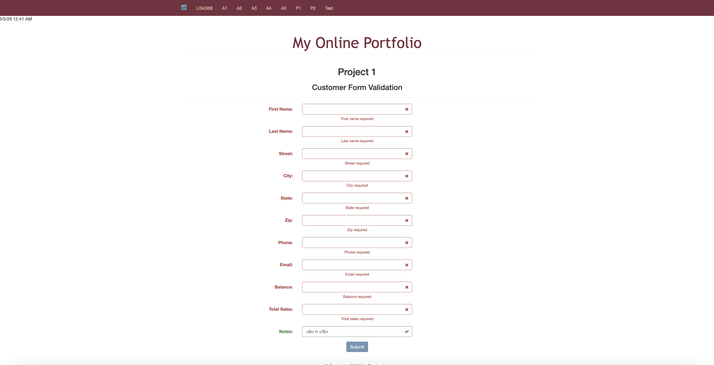
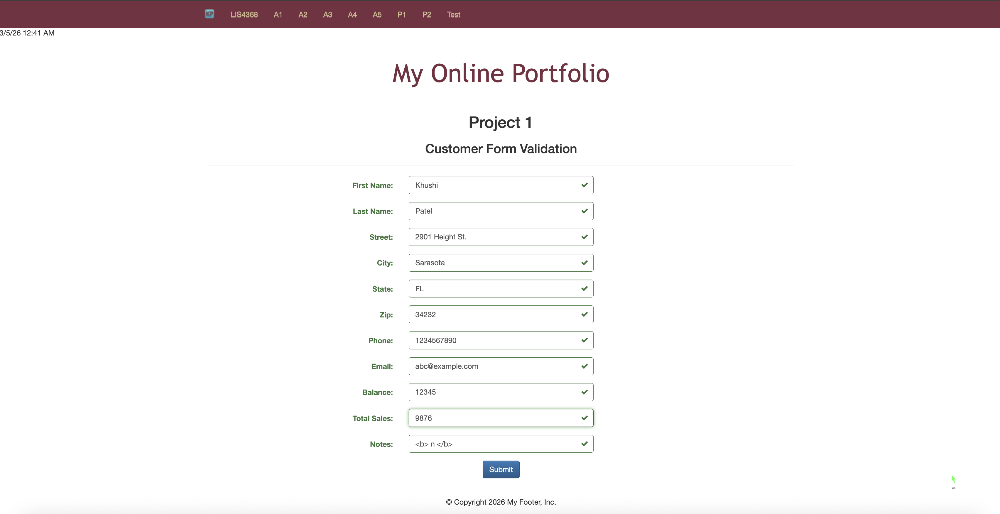
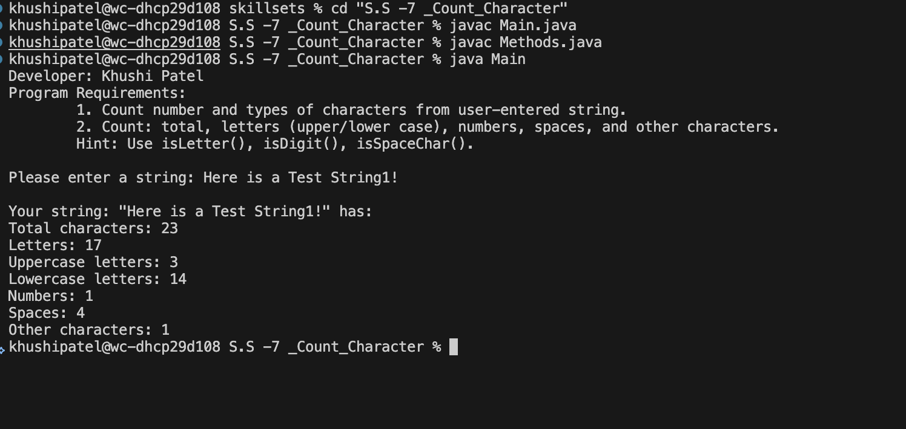
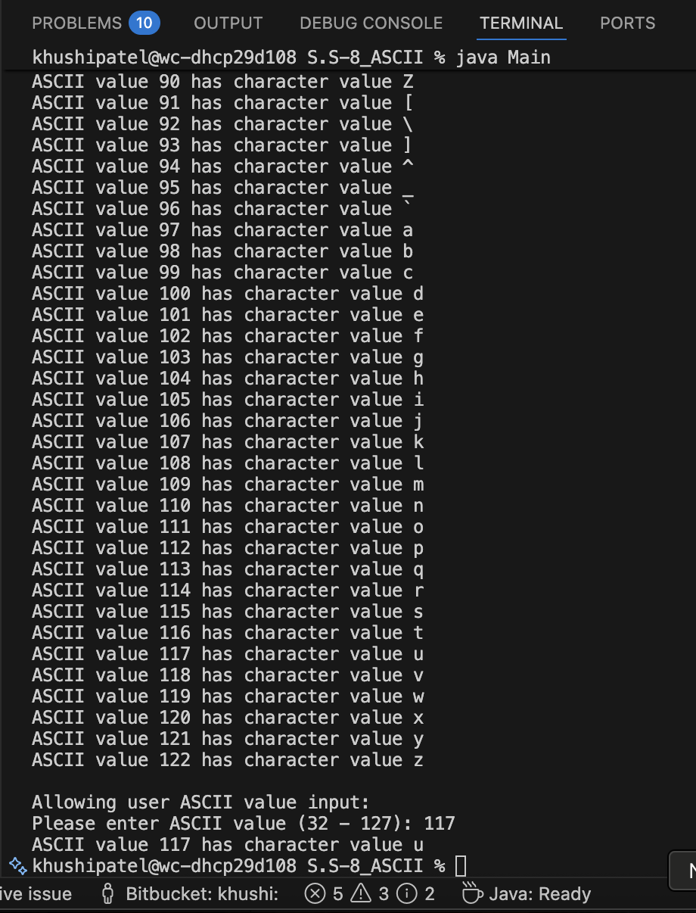

Delete this file and place _your_ README.md file here.

# Project 1 (P1) — LIS4368

## Overview

This project is a JSP-based customer form that demonstrates:

- Bootstrap UI layout with shared includes (nav, header, footer)
- Client-side validation using jQuery FormValidation + regular expressions
- Required fields for all customer attributes except Notes
- Clear validation feedback (failed and passed validation states)

---

## Deliverables Checklist

- Bitbucket course repo access provided to instructor (Read-only)
- README includes required screenshots (Portal, Failed Validation, Passed Validation)
- Submitted Bitbucket repo link in FSU LMS
- Carousel on the LIS4368 Portal includes at least 3 slides created by me with text and images linking to other content areas

---

## How to Run

1. Pull the latest code from Bitbucket.
2. Deploy the project on your Java web server (Tomcat) or course environment.
3. Open the portal page, then navigate to **Project 1**.
4. Test validation:
   - Leave required fields empty to trigger failed validation
   - Enter valid inputs to confirm passed validation

---

## Validation Rules Implemented (Customer Entity)

All fields are required except `cus_notes`.

- `cus_fname`, `cus_lname`
  - Required
  - Letters and hyphens only
  - Max length enforced

- `cus_street`
  - Required
  - Max 30 characters
  - Letters, numbers, commas, hyphens, periods, spaces

- `cus_city`
  - Required
  - Max 30 characters
  - Letters, numbers, hyphens, spaces

- `cus_state`
  - Required
  - Exactly 2 characters
  - Letters only

- `cus_zip`
  - Required
  - 5 to 9 digits
  - Numbers only

- `cus_phone`
  - Required
  - Exactly 10 digits
  - Numbers only

- `cus_email`
  - Required
  - Valid email format using regex
  - Max length enforced

- `cus_balance`, `cus_total_sales`
  - Required
  - Max 6 characters (including decimal point if used)
  - Numbers and optional decimal point

- `cus_notes`
  - Optional
  - Max 255 characters

---

## What the Validation Icons Mean

The validation plugin shows icons next to inputs:

- `fa fa-check` shows when a field passes validation
- `fa fa-times` shows when a field fails validation
- `fa fa-refresh` shows while a field is validating

---

## Screenshots

### LIS4368 Portal (Main/Splash Page)

### Failed Validation

### Passed Validation

---

## Skillsets Screenshots

### Skillset 7

### Skillset 8

### Skillset 9

---
