# LIS4368 - Project 2

## Khushi Patel

Course: LIS4368 - Mobile Web Application Development

---

## Project 2 Requirements

Project 2 completes the JSP/Servlets web application using the MVC framework and CRUD functionality. This project includes:

1. Review the cloned `lis4368_student_files` Bitbucket repo, especially `META-INF` and `WEB-INF`.
2. Ensure each assignment/project has its own `global` subdirectory.
3. Include server-side validation from Assignment 4.
4. Complete CRUD functionality for the customer table:
   - Create
   - Read
   - Update
   - Delete
5. Compile and use the required Java class and servlet files.
6. Update JSP pages to support customer form entry, display, modify, and delete flows.
7. Provide required screenshots in this README.
8. Push all updated files to the remote Bitbucket repository and submit the repo link.

> README.md file (for P2) should include the following items:
>
> 1. Course title, your name, and project requirements.
> 2. Screenshot of valid user form entry.
> 3. Screenshot of passed validation (`thanks.jsp`).
> 4. Screenshot of display data (`customers.jsp`).
> 5. Screenshot of modify form (`modify.jsp`).
> 6. Screenshot of modified data (`customers.jsp`).
> 7. Screenshot of delete warning (`customers.jsp`).
> 8. Screenshot(s) of associated database changes for insert, update, and delete.

---

## Project 2 Screenshots

> All images are stored in the `p2/img/` directory. Update file names if yours differ.

### 1. Failed Validation

_Screenshot showing failed validation on the customer form:_

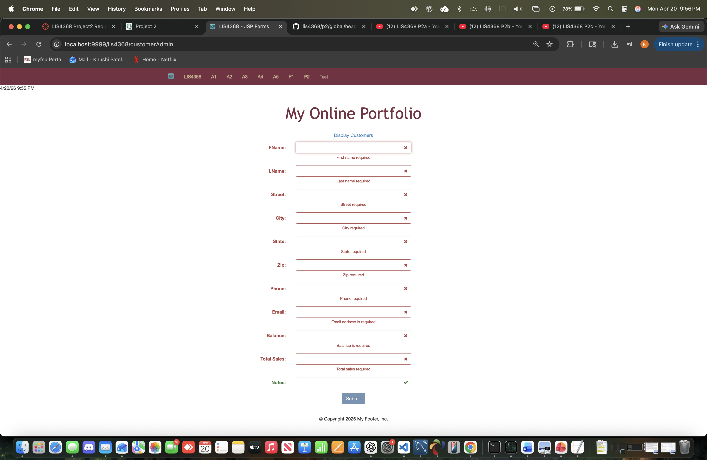

---

### 2. Validation Test

_Screenshot showing validation behavior during testing:_

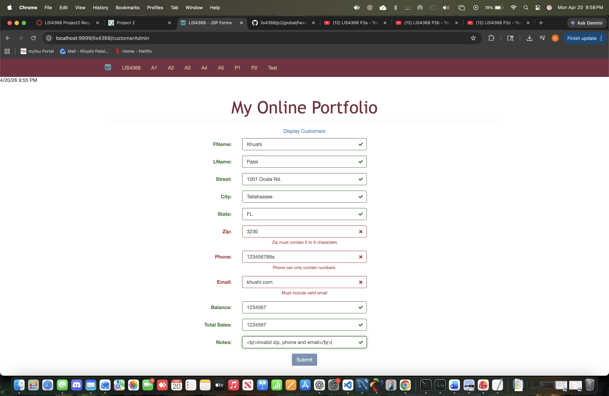

---

### 3. Valid User Form Entry

_Screenshot showing valid form entry in `customerform.jsp`:_

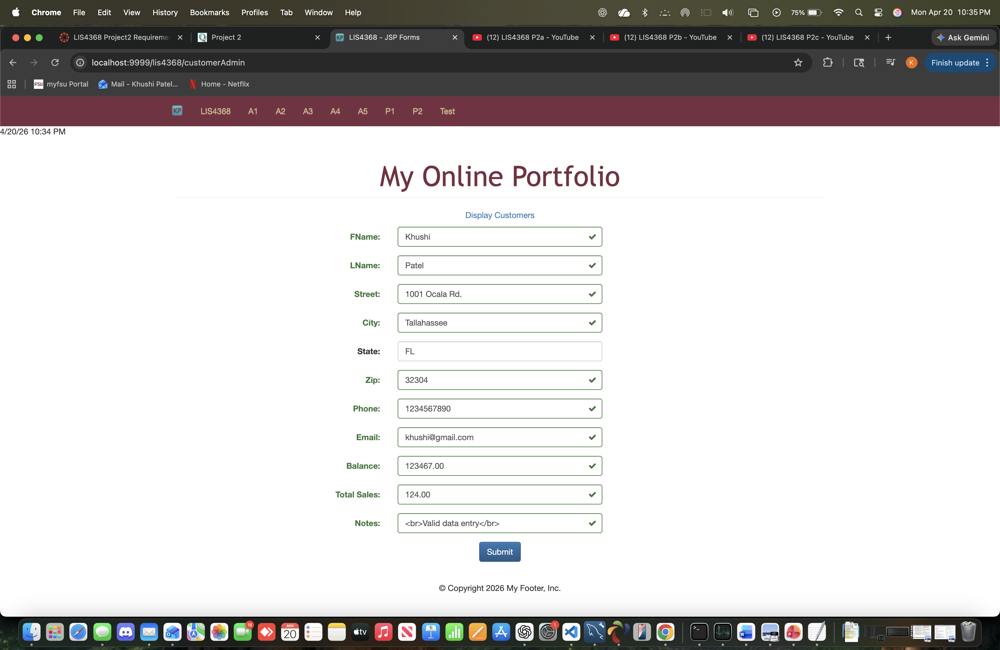

---

### 4. Passed Validation

_Screenshot showing successful submission in `thanks.jsp`:_

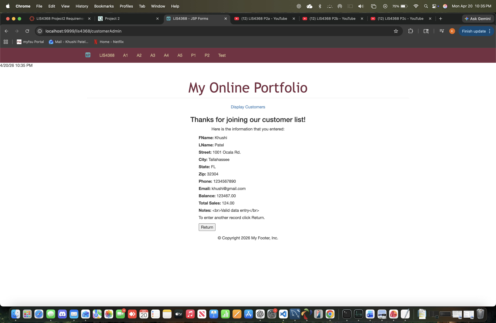

---

### 5. Display Data

_Screenshot showing customer records displayed in `customers.jsp`:_

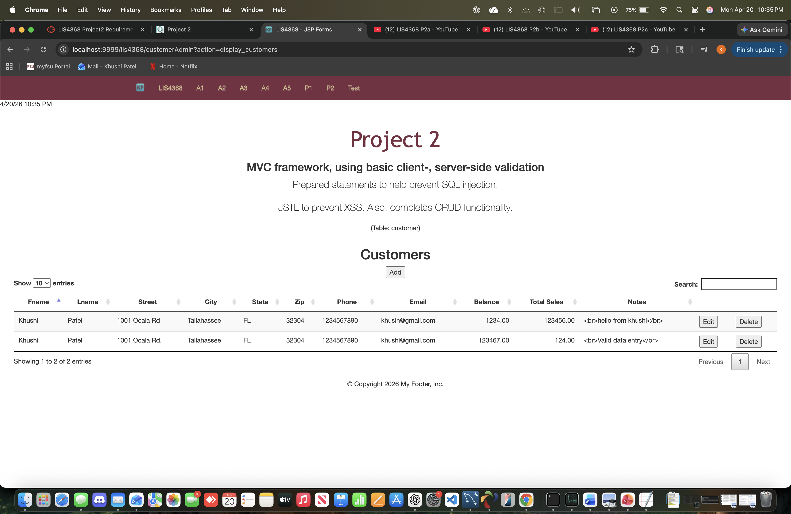

---

### 6. Modify Form

_Screenshot showing the update form in `modify.jsp`:_

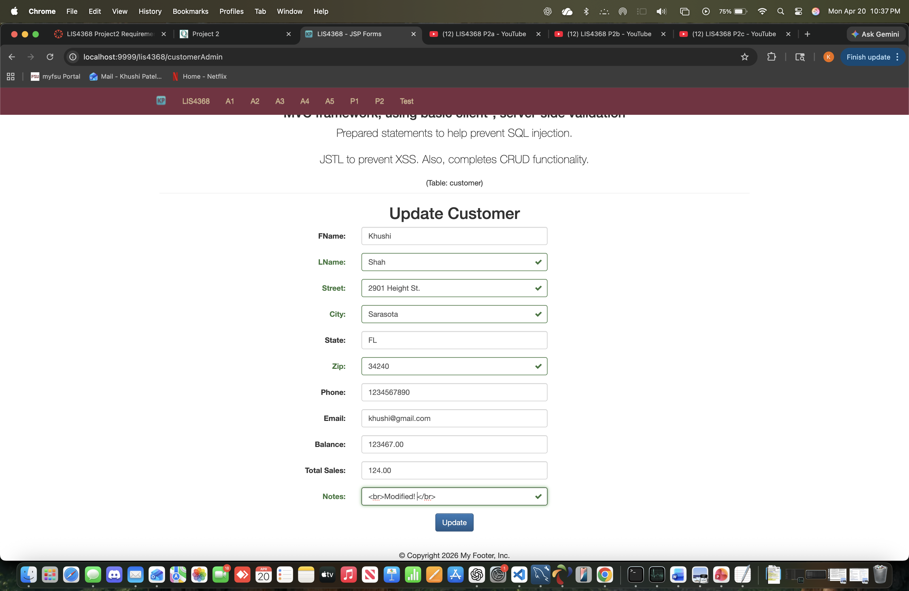

---

### 7. Modified Data

_Screenshot showing updated customer data in `customers.jsp`:_

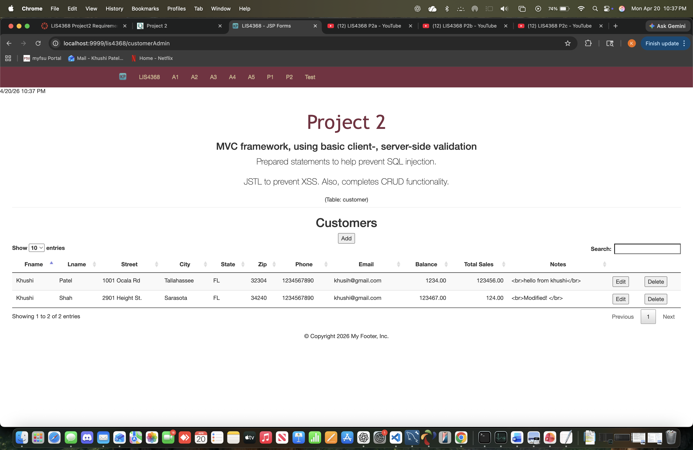

---

### 8. Delete Warning

_Screenshot showing the delete confirmation dialog:_

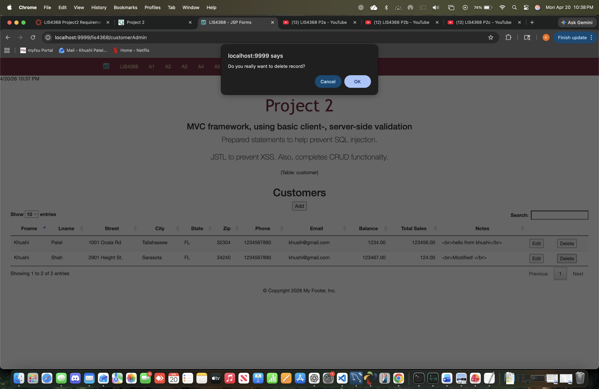

---

## Database Change Screenshots

### 1. Valid Insert in Database

_Screenshot showing inserted record in the customer table:_

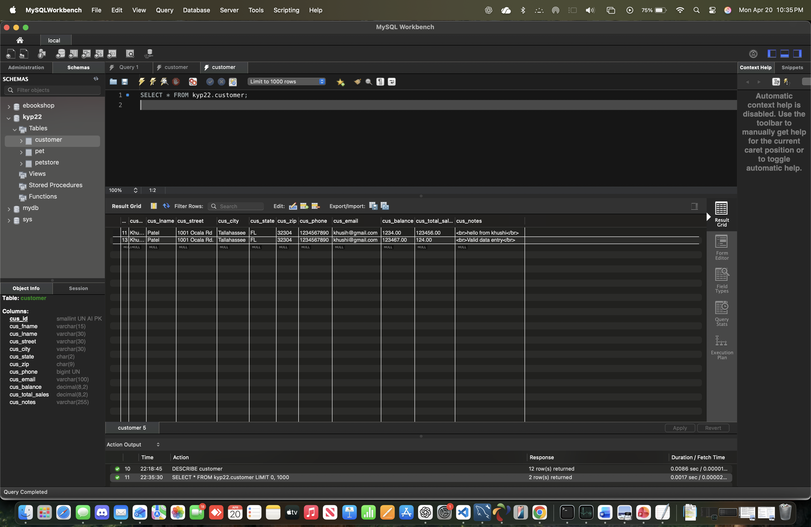

### 2. Modified Record in Database

_Screenshot showing updated record in the customer table:_

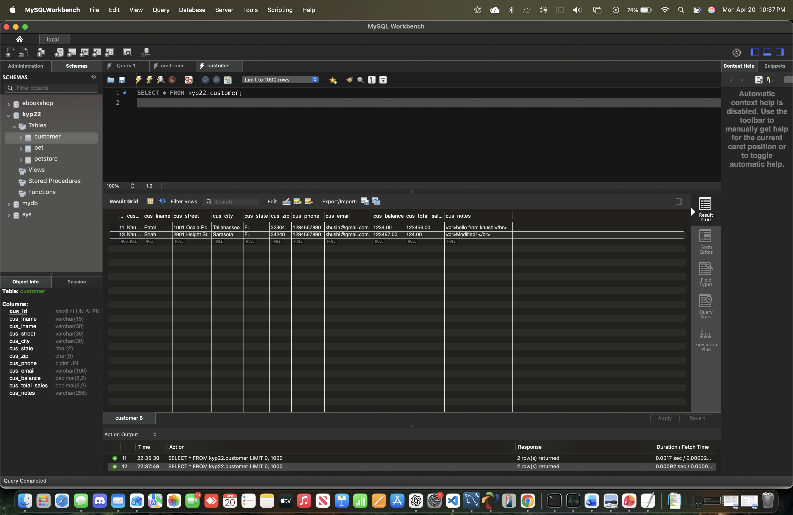

### 3. Deleted Record in Database

_Screenshot showing deleted record reflected in the customer table:_

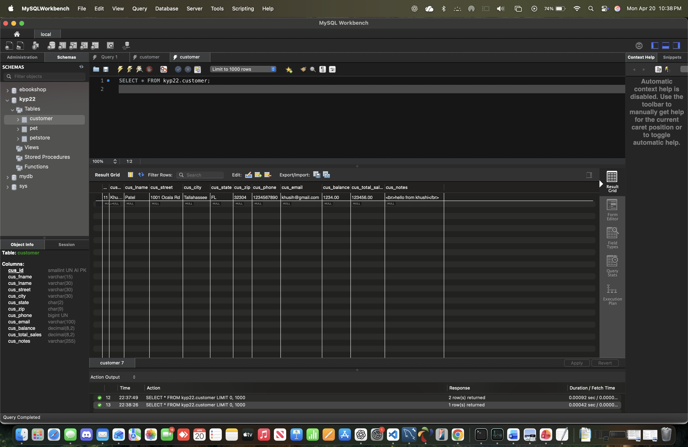

---

## Additional List Screenshots

### 1. List After Valid Insert

_Screenshot showing the list after a valid insert:_

### 2. List After Delete

_Screenshot showing the list after delete:_

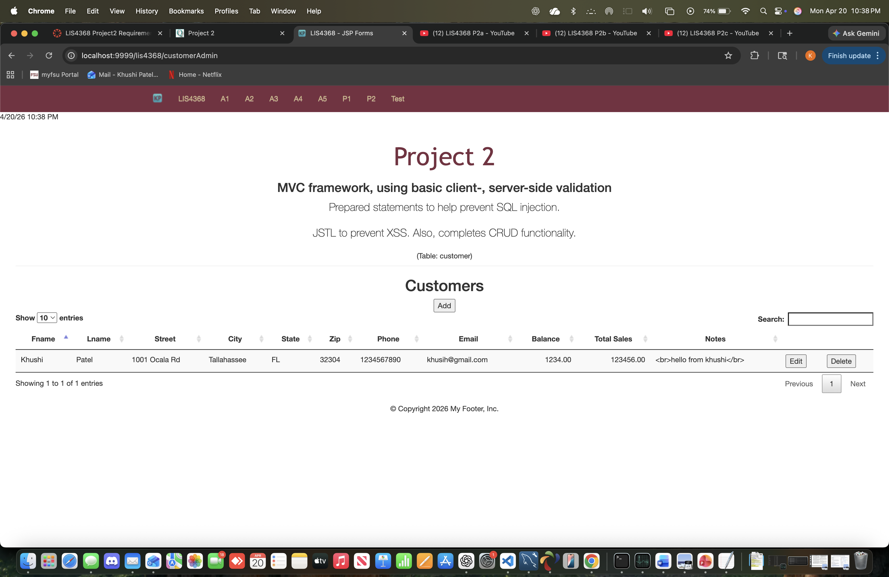

---
